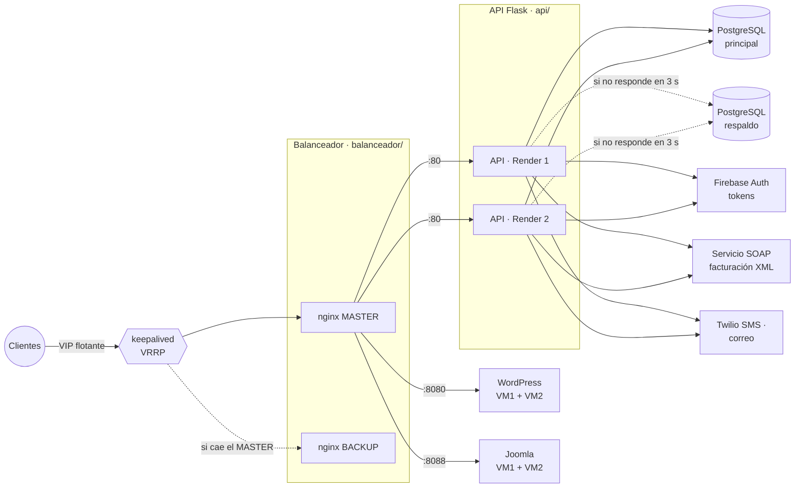

# TechStore 360 · API distribuida con balanceo y alta disponibilidad

<p>
  
  
  
  
  
</p>

Proyecto de **aplicaciones distribuidas**: una tienda de tecnología cuya API REST se despliega en **dos
instancias** de Render detrás de un **balanceador nginx** con **alta disponibilidad** (keepalived con IP
virtual flotante). El mismo balanceador reparte el tráfico de dos sitios WordPress y dos Joomla en máquinas
virtuales.

## Arquitectura



## Lo interesante

- **Puentes por cabecera Host.** Render enruta por la cabecera `Host`, y un `upstream` de nginx no puede
  cambiarla por servidor. El balanceador levanta dos servidores locales (`127.0.0.1:9081` y `:9082`) que
  hacen de puente y fijan el `Host` correcto hacia cada instancia.
- **Conmutación de base de datos.** Al arrancar, la API intenta la base principal y, si no responde en 3 s,
  usa la de respaldo (`api/db.py`).
- **Alta disponibilidad del balanceador.** keepalived comprueba cada 2 s que nginx siga vivo y mueve la IP
  virtual al nodo BACKUP si el MASTER falla.
- **Arranques en frío.** Timeouts de 60 s en nginx y gunicorn para absorber el *cold start* de Render, y
  errores de nginx con cabeceras CORS para que el navegador vea el error real.
- **SMTP solo por IPv4.** Render no tiene salida IPv6, y el cliente SMTP fuerza IPv4 para evitar
  `Network unreachable`.

## API

| Método | Ruta | Acceso |
|---|---|---|
| `GET` | `/health` | Público |
| `POST` | `/api/usuarios/registro` | Token de Firebase: crea el perfil local tras registrarse en Firebase |
| `GET` | `/api/usuarios/me` | Token de Firebase |
| `GET` · `PUT` · `DELETE` | `/api/usuarios`, `/api/usuarios/{id}` | Administrador |
| `GET` | `/api/productos`, `/api/productos/{id}` | Público |
| `POST` · `PUT` · `DELETE` | `/api/productos`, `/api/productos/{id}` | Administrador |
| `POST` | `/api/compras` | Token: registra la compra, pide la factura al servicio SOAP y envía avisos |
| `GET` | `/api/compras/mias` · `/api/compras` | Token · Administrador |

## Despliegue

**API (`api/`):** servicio Docker en Render, desplegado dos veces con `render.yaml`. Variables:
`DATABASE_URL`, `DATABASE_URL_REPLICA`, `FIREBASE_CREDENTIALS_JSON`, `SOAP_URL`, `TWILIO_*`, `SMTP_*`
(ver `api/.env.example`).

**Balanceador (`balanceador/`):** en cada nodo,

```bash
cd balanceador
docker compose --env-file nginx.env up -d      # hosts de Render e IP de las VM en nginx.env
```

y keepalived en el sistema con `keepalived/keepalived-master.conf` o `keepalived-backup.conf` (ajustar la
interfaz de red, la IP virtual y `auth_pass`).

## Estructura

```
├── api/            Flask + SQLAlchemy · rutas usuarios, productos, compras · SOAP · notificaciones
└── balanceador/    nginx (plantilla con envsubst) · keepalived MASTER/BACKUP · Render
```

## Historial

Une los repositorios `TechStore-Api` y `TechStore-BalanceadorCarga`; su historia se conservó con
`git subtree` en `api/` y `balanceador/`.
